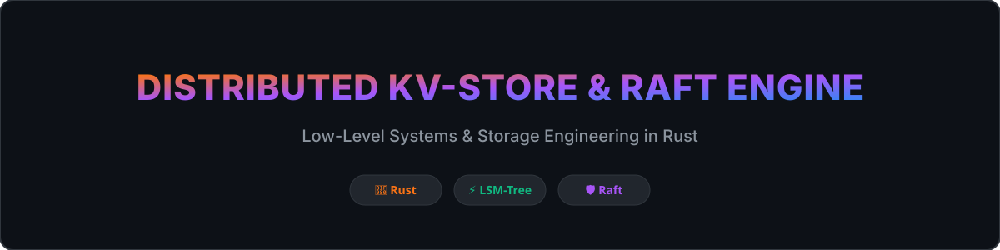
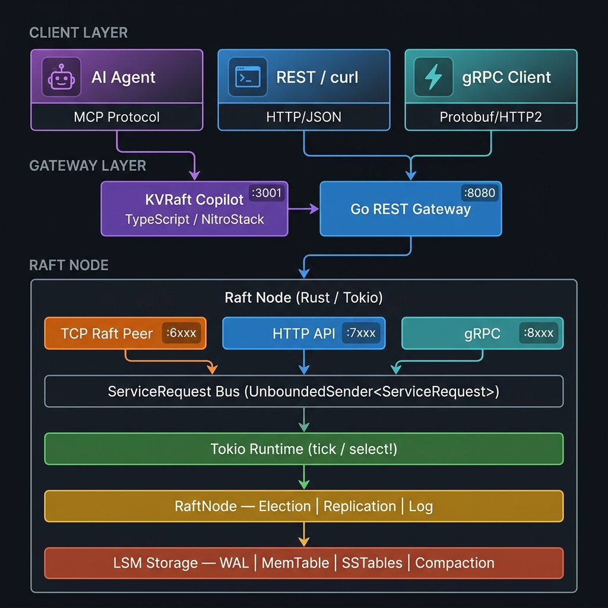
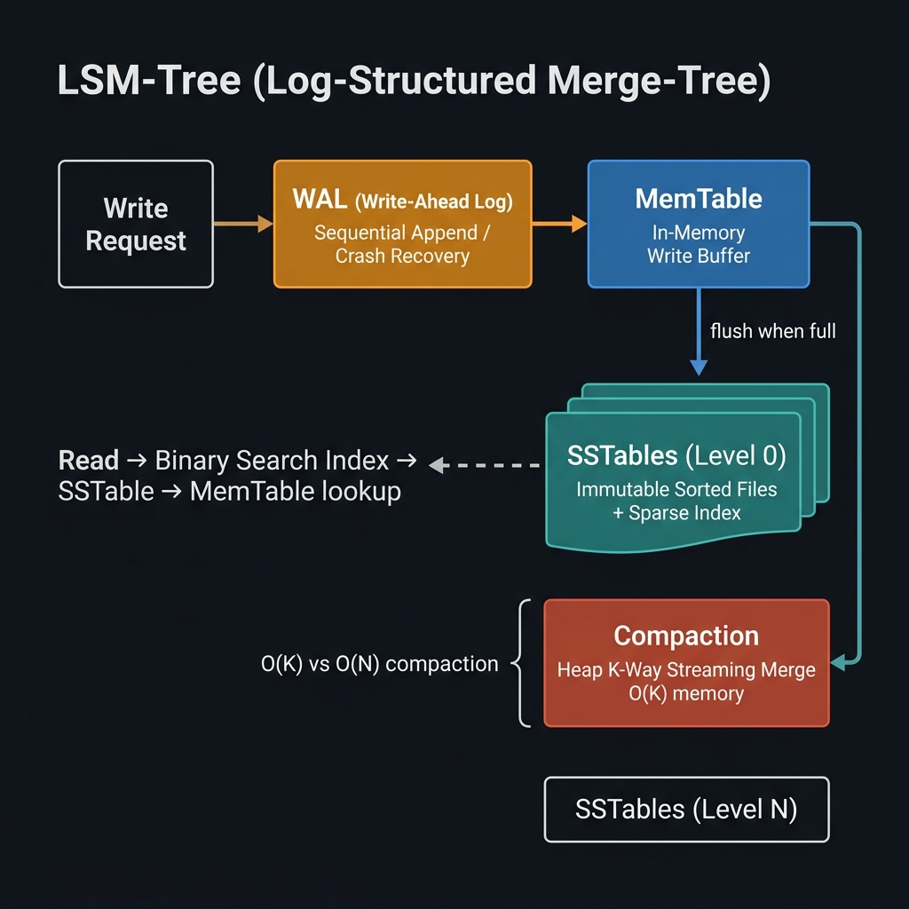
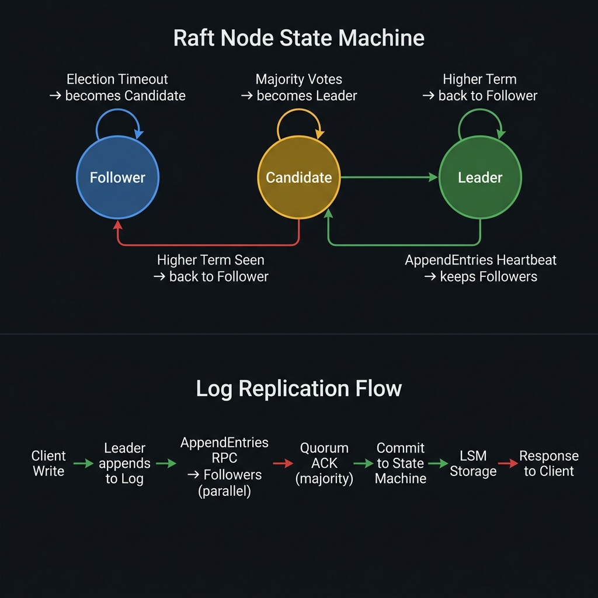
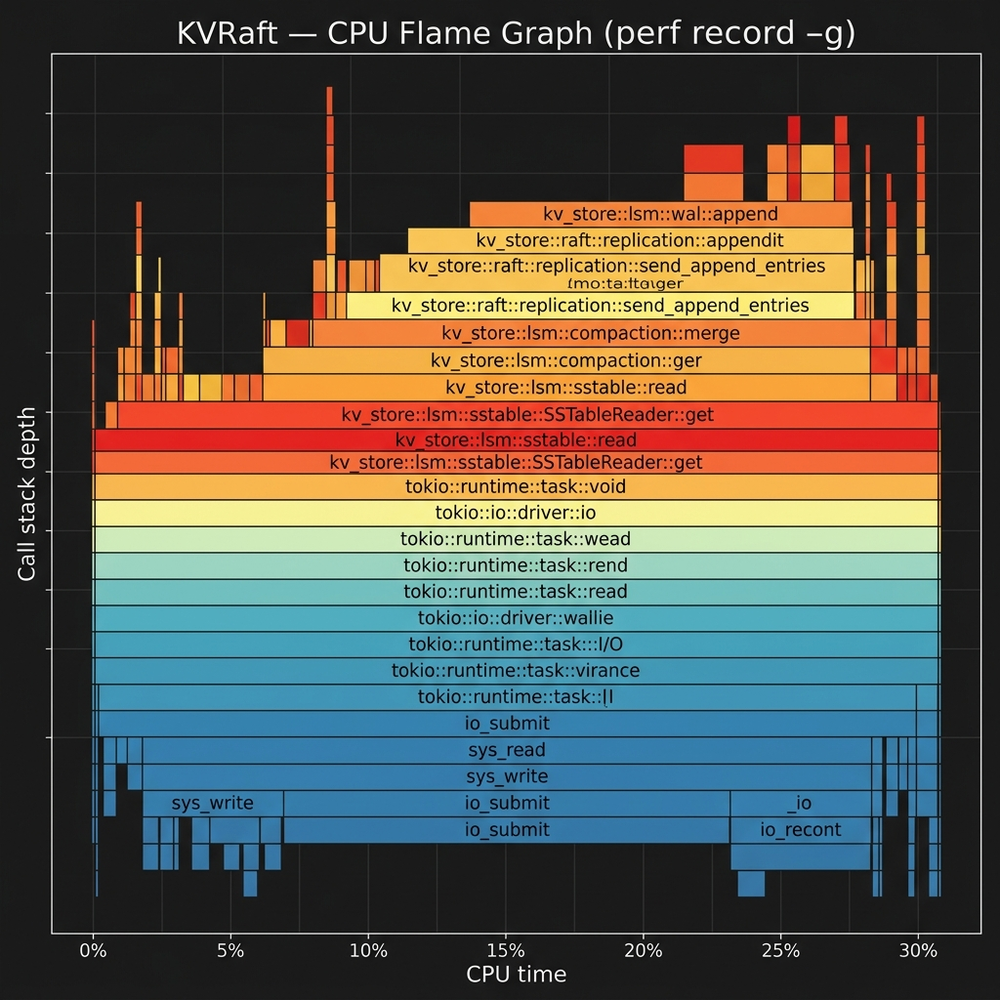
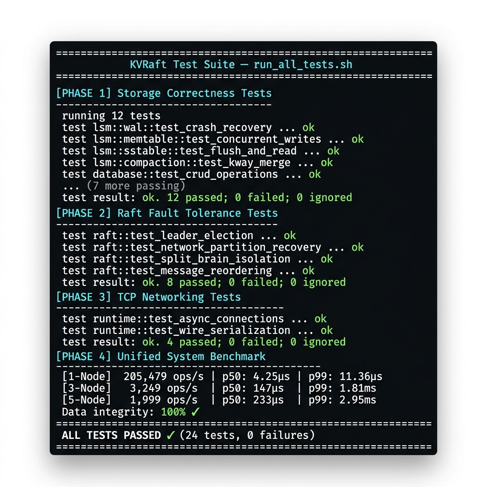

<div align="center">

# KVRaft — Distributed Key-Value Store & Consensus Engine

**A high-performance, fault-tolerant distributed key-value database built from scratch in Rust.**

---



</div>

## Executive Summary

KVRaft is a low-level systems and distributed infrastructure engine implementing a **persistent LSM-tree storage layer** paired with a **custom Raft consensus & replication protocol**, built from scratch in Rust over Tokio. The system exposes a **native gRPC API** (protobuf/tonic), a **REST/JSON gateway** written in Go, and an **AI-native MCP Copilot** (TypeScript/NitroStack) that gives AI agents first-class tool access to the live cluster.

Designed as an engineering showcase in **systems programming**, **concurrent I/O**, **zero-copy streaming**, **consensus safety**, and **profiling-driven optimization**, KVRaft provides both single-node high-throughput key-value operations and strong consistency across multi-node Raft clusters.

---

## Key Engineering Highlights

- **LSM-Tree Storage Engine**: Persistent Write-Ahead Logging (WAL), in-memory MemTable, immutable SSTables with sparse index blocks, and a memory-efficient $O(K)$ streaming k-way merge compaction pipeline.
- **Raft Consensus Protocol**: Custom implementation featuring Leader Election, Log Replication, Quorum Commit, Log Matching & Conflict Resolution, Follower Catch-up, and Stale Leader Fencing.
- **Triple-Ingress API Layer**: Every node simultaneously exposes a native binary Raft TCP peer port, a JSON/REST HTTP port (via Go gateway), and a gRPC port (protobuf/tonic) — all funneling through a single unified `ServiceRequest` pipeline.
- **AI-Native MCP Copilot**: A NitroStack MCP server (`kvraft-copilot`) that gives any MCP-compatible AI agent (Cursor, Copilot, Claude Desktop, etc.) structured tool access to inspect and operate the live cluster over the REST gateway.
- **Fault-Tolerance Verification**: Robust test harness simulating network partitions, packet drops, message reordering, follower restart, and split-brain scenarios.
- **Profiling-Driven Optimization**: Linux `perf` and flamegraph profiling resulting in zero unnecessary allocations, buffered I/O, reused SSTable file descriptors, and streaming compaction.

---

## Benchmark & System Metrics

Recorded on a local Linux benchmark suite running Release mode optimizations (`./run_all_tests.sh`):

| Workload Phase | Throughput (ops/sec) | p50 Latency | p95 Latency | p99 Latency |
| :--- | :--- | :--- | :--- | :--- |
| **Standalone Read (Hit)** | **205,479 ops/s** | 4.25 µs | 6.52 µs | 11.36 µs |
| **Standalone Read (Miss)** | **1,314,177 ops/s** | 634 ns | 990 ns | 1.14 µs |
| **Standalone Insert** | **68,139 ops/s** | 8.67 µs | 14.91 µs | 24.79 µs |
| **1-Node Raft Cluster** | **10,534 ops/s** | 43.42 µs | 430.76 µs | 664.20 µs |
| **3-Node Raft Cluster** | **3,249 ops/s** | 147.34 µs | 1.01 ms | 1.81 ms |
| **5-Node Raft Cluster** | **1,999 ops/s** | 233.93 µs | 1.85 ms | 2.95 ms |

> **Resource Footprint**: ~5.83 MB Process Memory (RSS) | ~100% Data Integrity Verification across all cluster configurations.

---

## System Architecture



### Port Map (per node)

| Port | Protocol | Purpose |
| :--- | :--- | :--- |
| `6xxx` | TCP (binary) | Raft P2P consensus (RequestVote, AppendEntries) |
| `7xxx` | HTTP/JSON | REST API (via Go gateway at `:8080`) |
| `8xxx` | gRPC (HTTP/2) | Native gRPC client access |
| `8080` | HTTP/JSON | Go REST Gateway (aggregates cluster) |
| `3001` | HTTP/SSE | MCP Copilot server (AI agent tools) |

---

## Technical Implementation

### 1. Storage Engine (LSM-Tree)

- **WAL & Crash Recovery**: Synchronous sequential append log recording every state mutation before MemTable insertion. Replayed automatically on node restart.
- **MemTable & SSTable Flush**: In-memory write buffer flushed to SSTables with binary search index blocks for $O(\log N)$ point lookups.
- **Streaming K-Way Merge Compaction**: Replaced memory-heavy $O(N)$ hash-table merges with a heap-based $O(K)$ streaming merge, processing sorted SSTable iterators directly to disk without loading full datasets into RAM.



### 2. Raft Consensus Engine

- **Asynchronous Tokio TCP Transport**: Custom binary length-prefixed protocol using Bincode serialization for P2P consensus RPCs (`RequestVote`, `AppendEntries`).
- **Log Replication & Quorum Commit**: Leader-driven log entry replication requiring majority ACK before committing to state machine.
- **Linearizable Read & Forwarding**: Unified leadership checks ensure write requests are handled by the cluster leader, with automatic follower redirect.



### 3. gRPC API (Tonic / Protobuf)

Each node exposes a native gRPC endpoint (port `8xxx`) generated from `proto/kvraft.proto` using `tonic` and `prost`:

```protobuf
// proto/kvraft.proto
service KVStore {
  rpc Get    (GetRequest)    returns (KVResponse);
  rpc Set    (SetRequest)    returns (KVResponse);
  rpc Delete (DeleteRequest) returns (KVResponse);
  rpc Status (StatusRequest) returns (KVResponse);
}
```

The `GrpcKVStore` service in `src/runtime/grpc_service.rs` translates incoming protobuf requests into the shared `ServiceRequest` bus, identical to the REST path — no logic duplication.

### 4. Unified Request Pipeline

All three ingress paths (TCP binary Raft, HTTP REST, gRPC) are normalized into a single `ServiceOperation` enum and dispatched through the same `UnboundedSender<ServiceRequest>` channel into the Tokio runtime loop:

```
TCP Peer  ──┐
HTTP REST ──┼──▶  ServiceRequest Bus  ──▶  RaftNode  ──▶  LSM Storage
gRPC      ──┘
```

### 5. KVRaft Copilot — AI-Native MCP Server

`kvraft-copilot/` is a **NitroStack MCP server** written in TypeScript that gives any MCP-compatible AI agent structured, type-safe tool access to the live cluster. It connects to the Go REST gateway and exposes five tools:

| Tool | Description |
| :--- | :--- |
| `get_cluster_status` | Returns the current leader ID, Raft term, and cluster health. |
| `diagnose_nodes` | Independently probes every configured node for reachability, latency, and role. |
| `get_value` | Reads a typed key (`string` / `int` / `float`) from the cluster. |
| `set_value` | Writes a typed key-value pair through the leader. |
| `delete_key` | Deletes a key from the cluster. |

```bash
# Start the MCP server (dev mode)
cd kvraft-copilot
npm install
npm run dev
```

The server auto-negotiates between the **2026-07-28 stateless MCP spec** and the legacy **2025-06-18 sessionful spec** depending on the client.

---

## Performance & Profiling

Linux `perf` and flamegraph profiling were used to eliminate bottleneck syscalls and memory allocations:



- **Zero-Allocation Readers**: Reused file descriptors and pre-allocated binary buffers during SSTable reads and WAL recovery.
- **Buffered I/O**: `BufReader` / `BufWriter` wrapping disk streams to minimize kernel context switches during sequential writes.
- **Streaming Heap Merger**: Eliminates memory allocation spikes during multi-level compaction.

---

## Testing & Verification

Includes a comprehensive, automated 4-phase test suite (`./run_all_tests.sh`):



```bash
# Run the complete test suite
./run_all_tests.sh
```

- **Phase 1 (Storage Correctness)**: CRUD operations, WAL recovery, flush & compaction, concurrent reads/writes.
- **Phase 2 (Raft Fault Tolerance)**: Elections, network partitions, split-brain isolation, message drops & reordering.
- **Phase 3 (TCP Networking)**: Tokio async connection management, wire serialization.
- **Phase 4 (Unified System Stress & Benchmarks)**: End-to-end data integrity checks across 1, 3, and 5-node active clusters.

---

## Getting Started

### Prerequisites

- **Rust Toolchain**: `rustc` / `cargo` (1.80+, edition 2024)
- **Linux Environment** (recommended for `perf` and full bash test suite)
- **Go** (for the REST gateway in `api/`)
- **Node.js 20+** (for the MCP Copilot in `kvraft-copilot/`)
- **Docker & Docker Compose** (optional, for containerized deployment)

### Quick Start — Single Node

```bash
# Clone the repository
git clone https://github.com/KrishnaAdityaSrivastava/Rust-Database.git
cd Rust-Database

# Build release binary
cargo build --release

# Run master test & benchmark suite
./run_all_tests.sh
```

### Running a Multi-Node Raft Cluster (Manual)

Each node exposes three ports: Raft TCP (`6xxx`), HTTP API (`7xxx`), and gRPC (`8xxx`).

```bash
# Terminal 1 — Node 1
cargo run --bin node -- \
  --id 1 --addr 127.0.0.1:6001 \
  --api-addr 127.0.0.1:7001 \
  --grpc-addr 127.0.0.1:8001 \
  --peers 2:127.0.0.1:6002,3:127.0.0.1:6003

# Terminal 2 — Node 2
cargo run --bin node -- \
  --id 2 --addr 127.0.0.1:6002 \
  --api-addr 127.0.0.1:7002 \
  --grpc-addr 127.0.0.1:8002 \
  --peers 1:127.0.0.1:6001,3:127.0.0.1:6003

# Terminal 3 — Node 3
cargo run --bin node -- \
  --id 3 --addr 127.0.0.1:6003 \
  --api-addr 127.0.0.1:7003 \
  --grpc-addr 127.0.0.1:8003 \
  --peers 1:127.0.0.1:6001,2:127.0.0.1:6002
```

### Running with Docker Compose

```bash
# Spin up the full stack (3 Raft nodes + Go gateway + MCP Copilot + Prometheus + Grafana)
docker compose up --build
```

| Service | URL |
| :--- | :--- |
| Go REST Gateway | `http://localhost:8080` |
| MCP Copilot | `http://localhost:3001` |
| Prometheus | `http://localhost:9090` |
| Grafana | `http://localhost:3000` |

### Interactive CLI Client

```bash
cargo run --bin client -- 127.0.0.1:6001
```

### KVRaft Copilot (MCP Server)

```bash
cd kvraft-copilot
cp .env.example .env   # configure KVRAFT_GATEWAY_URL
npm install
npm run dev            # starts MCP server on STDIO (dev) or HTTP SSE (prod)
```

Point your MCP client (Cursor, Claude Desktop, GitHub Copilot, etc.) at the running server to get tool-assisted cluster management.

---

## Project Structure

```text
.
├── api/                       # Go REST/HTTP Proxy Gateway (:8080)
│   └── main.go
├── kvraft-copilot/            # AI-Native MCP Server (TypeScript/NitroStack)
│   ├── src/
│   │   ├── modules/
│   │   │   └── kvraft/
│   │   │       ├── kvraft.module.ts   # NitroStack module registration
│   │   │       └── kvraft.tools.ts    # MCP tools (get, set, delete, status, diagnose)
│   │   └── index.ts                   # McpApplicationFactory bootstrap
│   ├── package.json
│   └── Dockerfile
├── proto/
│   └── kvraft.proto           # Protobuf schema for gRPC API
├── src/
│   ├── bin/
│   │   ├── node.rs            # Raft node binary (TCP + HTTP + gRPC)
│   │   ├── client.rs          # Interactive CLI client
│   │   └── bench.rs           # Benchmark harness
│   ├── database/              # High-level Database handle, recovery & compaction
│   ├── lsm/                   # Storage layer (MemTable, SSTable, WAL, format)
│   ├── raft/                  # Consensus engine (Node, Election, Replication, Network)
│   └── runtime/
│       ├── runtime.rs         # Tokio event loop (tick / select!)
│       ├── service.rs         # ServiceRequest / ServiceOperation types
│       ├── grpc_service.rs    # gRPC tonic server (→ ServiceRequest bus)
│       ├── fault.rs           # Network fault injection
│       └── simulator.rs       # In-process cluster simulator for tests
├── tests/                     # Integration & fault tolerance test suites
│   ├── correctness.rs
│   ├── raft_fault_tolerance.rs
│   ├── raft_network.rs
│   └── unified_suite.rs
├── build.rs                   # tonic-prost-build proto compilation
├── compose.yaml               # Full-stack Docker Compose
├── prometheus.yml             # Prometheus scrape config
└── run_all_tests.sh           # Master test automation script
```

---

## License

Distributed under the [MIT License](LICENSE).
